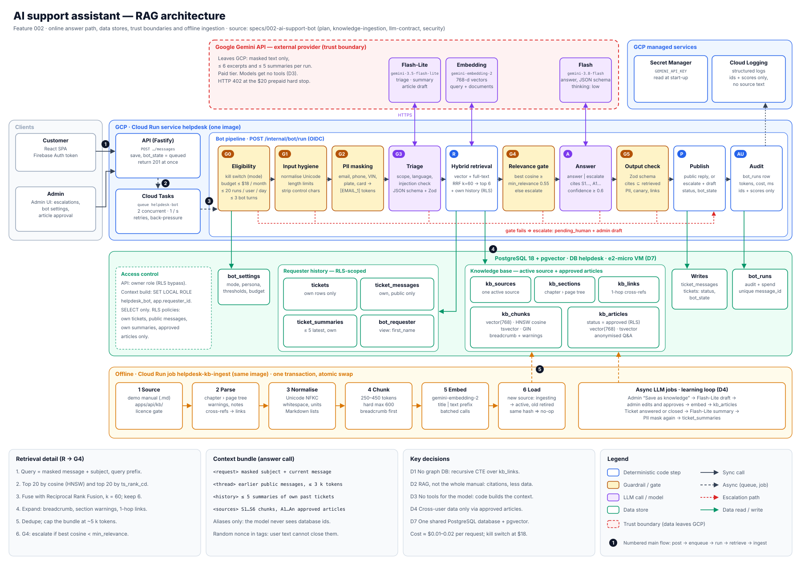

# Plan — Feature 002 (AI support assistant)

Read with: [spec](spec.md) · [data model](data-model.md) · [knowledge ingestion](knowledge-ingestion.md) ·
[security](security.md) · [LLM contract](llm-contract.md) · [testing](testing.md) ·
[API contract](contracts/api.md) · [tasks](tasks.md)

## Architecture



```
User ──POST message──▶ API (Cloud Run "helpdesk")
                         │ 1. save message, status unchanged, bot_state=queued
                         │ 2. enqueue Cloud Task (ticketId, messageId)  ── returns 201 immediately
                         ▼
                 Cloud Tasks queue "helpdesk-bot" (retries, rate limit)
                         │ OIDC-signed POST /internal/bot/run
                         ▼
        ┌──────────── Bot pipeline (same Cloud Run service, internal route) ─────────────┐
        │ G0 eligibility: kill switch, budget, per-user quota, bot enabled on ticket,     │
        │    ≤ 3 bot turns                                                                │
        │ G1 input hygiene: normalise, limits, strip control chars                        │
        │ G2 PII masking (emails, phones, VIN, plates, cards → [EMAIL_1] …)               │
        │ G3 triage ── gemini-3.5-flash-lite (structured) ── scope, language, injection │
        │ R  retrieval (code, not LLM): hybrid search manual + approved KB articles       │
        │    + requester's own history (RLS-scoped DB role)                               │
        │ G4 relevance gate (score threshold) ── fail ⇒ escalate                          │
        │ A  answer ── gemini-3.8-flash (structured: answer | escalate, citations)        │
        │ G5 output validation: schema, citation ⊆ retrieved, PII/canary/link checks      │
        │ P  publish reply (public) or escalate (+ internal draft for admins)             │
        │ AU audit row in bot_runs                                                        │
        └─────────────────────────────────────────────────────────────────────────────────┘
                         │
                         ▼
          PostgreSQL 18 + pgvector (e2-micro VM)   ◀── KB ingest job (Cloud Run job)
```

Why async (Cloud Tasks) and not in the request: Cloud Run throttles CPU after the
response is sent, LLM calls take 5–40 s, and Tasks gives retries, back-pressure and a
global rate limit for free (1 M operations / month).

## Stack additions

| Concern                                 | Choice                                                                               | Why                                                                          |
| --------------------------------------- | ------------------------------------------------------------------------------------ | ---------------------------------------------------------------------------- |
| LLM — answers                           | **Gemini 3.8 Flash** (`gemini-3.8-flash`, paid tier) via `@google/genai`             | Cheap and fast; `thinking_level: low`; no tools.                             |
| LLM — triage, summaries, article drafts | **Gemini 3.5 Flash-Lite** (`gemini-3.5-flash-lite`)                                  | Cheapest model ($0.30 / $2.50 per MTok) for classification and short text.   |
| Structured output                       | `response_format` JSON schema, validated again with Zod                              | No free-text parsing; schema-checked decisions.                              |
| Safety blocks                           | Gemini safety settings incl. the `jailbreak` category; a blocked request ⇒ escalate  | Extra provider-side injection filter.                                        |
| Embeddings                              | **`gemini-embedding-2`**, 768 dimensions                                             | Same provider, no model to host in Cloud Run; corpus costs < $0.01 to embed. |
| Vector + full-text search               | **pgvector** (HNSW, cosine) + Postgres `tsvector` (english) → Reciprocal Rank Fusion | One database, hybrid recall; corpus is small (~1–2 k chunks).                |
| Queue                                   | Cloud Tasks queue `helpdesk-bot` (max 2 concurrent, 1/s)                             | Free tier, OIDC auth to Cloud Run.                                           |
| Secrets                                 | `GEMINI_API_KEY` in Secret Manager                                                   | Constitution §3.                                                             |

The Postgres image changes from `postgres:18-alpine` to **`pgvector/pgvector:pg18`**
(mirrored into Artifact Registry like today). Data directory layout is compatible; the
change is applied by re-creating the container, the data disk is kept.

## Decisions

### D1 — No graph database

The content is a **tree** (chapter → section → page → chunk) with a few hundred
**cross-reference edges** and "warning belongs to section" relations. Queries needed:
"chunk + its breadcrumb + its section's warnings + 1-hop cross-referenced sections".
That is a recursive CTE over two adjacency tables in Postgres (<1 ms at this size).
A graph DB (Neo4j etc.) has no GCP free tier, adds a second datastore to secure and
back up, and brings no capability we need. **Revisit** only if we add multi-hop
reasoning over many products/parts catalogues.

### D2 — RAG instead of "whole manual in the prompt"

The whole demo manual (~20 k tokens) would fit Gemini Flash's 1 M-token context. We still choose RAG because: (a) citations must point at specific
sections (AC-1.3); (b) data minimisation — only the needed excerpts leave our infra;
(c) a relevance score gives a deterministic escalation signal (G4); (d) per-request
cost stays several times lower, and the design also works if a full-size licensed
manual is added later.

### D3 — The model gets no tools

Retrieval and history lookup are done by code, scoped by the authenticated requester,
before the model is called. The model receives a fixed bundle and returns one JSON
object. This removes the main prompt-injection blast radius (no tool can be coerced
into fetching other users' data). See [security.md](security.md).

### D4 — Cross-user learning only through approved articles

"Use previous user requests" across users is satisfied by admin-approved, anonymised
knowledge articles (AC-4.3). Raw tickets of other users are never retrieval candidates.

### D5 — Persona

Persona name and avatar come from `bot_settings`; the "AI assistant" badge is
hard-coded in the UI (spec D-Q2). Replies are stored with `author_role = 'bot'`.

### D6 — Original demo manual; third-party content never in git

No permission to use Renault's manual (spec D-Q1), so the knowledge base is an
original demo manual we write (`apps/api/kb/demo-duster-manual/`, our content, may be
in the public repo). Answers from it carry a "demo content" notice. Ingestion of
third-party content stays behind a licence gate and would live only in the private
database.

### D7 — One shared PostgreSQL database

Feature 002 uses the **same PostgreSQL 18 server** (the e2-micro VM) and the **same
`helpdesk` database** as feature 001. No second database or datastore is added.

- The car knowledge base lives in new `kb_*` tables next to the 001 tables. They have
  no foreign keys to `users`; `kb_articles.source_ticket_id` is the only link to 001
  data and is never shown to the model.
- 001 tables are only extended (new columns and enum values on `tickets` and
  `ticket_messages`), never restructured.
- The assistant reads 001 data only through the `helpdesk_bot` role, limited by
  row-level security to the requester's own rows (see data-model.md).
- Why one database: stays within the free tier, one backup and one set of credentials
  to manage, and transactions can cover a ticket and its knowledge-base data together.
- The server's container image changes to `pgvector/pgvector:pg18` (same Postgres 18,
  plus the vector extension); the data disk and all 001 data are kept.

## Bot state machine (per ticket)

| Event                                   | Condition                         | Ticket status      | `bot_state`                   |
| --------------------------------------- | --------------------------------- | ------------------ | ----------------------------- |
| user message                            | bot enabled for ticket & eligible | unchanged (`open`) | `queued`                      |
| bot answers                             | all gates pass                    | `answered`         | `idle`                        |
| bot escalates                           | any gate fails                    | `pending_human`    | `disabled`                    |
| user "Talk to a person" / "not helpful" | —                                 | `pending_human`    | `disabled`                    |
| admin replies                           | —                                 | `answered`         | `disabled` (until re-enabled) |
| admin re-enables bot                    | —                                 | unchanged          | `idle`                        |
| 4th user message in ticket              | bot turns = 3                     | `pending_human`    | `disabled`                    |

Status enum gains `pending_human` (see data model). User follow-ups on a
`pending_human` ticket keep it `pending_human`.

## Configuration

| Var / setting                                               | Where          | Default                                                             |
| ----------------------------------------------------------- | -------------- | ------------------------------------------------------------------- |
| `GEMINI_API_KEY`                                            | Secret Manager | —                                                                   |
| `BOT_MODEL_ANSWER` / `BOT_MODEL_TRIAGE` / `BOT_MODEL_EMBED` | Cloud Run env  | `gemini-3.8-flash` / `gemini-3.5-flash-lite` / `gemini-embedding-2` |
| `BOT_TASKS_QUEUE`, `BOT_TASKS_SA`, `BOT_INTERNAL_AUDIENCE`  | Cloud Run env  | —                                                                   |
| `KB_SOURCE_LICENSE_CONFIRMED` (third-party sources only)    | ingest job env | `false` (blocks ingestion)                                          |
| `bot_settings.mode`                                         | DB (admin UI)  | `off` → `live` (after the smoke checks pass)                        |
| `bot_settings.persona_name`                                 | DB             | `Alex Carter`                                                       |
| `bot_settings.min_relevance`                                | DB             | start 0.55 cosine; adjusted by hand on the demo manual              |
| `bot_settings.monthly_budget_usd`                           | DB             | 18 (kill switch below the $20 prepaid hard stop)                    |
| `bot_settings.max_runs_per_user_per_day`                    | DB             | 20                                                                  |

## Cost (constitution §2)

Assumes ~6 k input / ~1 k output tokens (incl. thinking) per answer and ~1.5 k / 300 per
triage call.

| Item                                                                      | Free tier? | Per handled request | 1 000 requests / month          |
| ------------------------------------------------------------------------- | ---------- | ------------------- | ------------------------------- |
| Cloud Tasks, Cloud Run, Postgres + pgvector (≈ 1 k chunks × 768-d ≈ 3 MB) | yes        | $0                  | $0                              |
| Triage — `gemini-3.5-flash-lite`                                          | no         | ≈ $0.001            | ≈ $1.20                         |
| Answer — `gemini-3.8-flash` (until 2026-12-31)                            | no         | ≈ $0.008            | ≈ $8                            |
| Answer — `gemini-3.8-flash` (from 2027-01-01, price doubles)              | no         | ≈ $0.017            | ≈ $17                           |
| Query embedding — `gemini-embedding-2`                                    | no         | < $0.0001           | ≈ $0.01                         |
| **Total**                                                                 |            | **≈ $0.01–0.02**    | **≈ $9–18**, within the $20 cap |

Budget enforcement (D-Q3): **$20 prepaid** Gemini balance with auto-reload off — the API
returns HTTP 402 when it is used up (hard stop); **AI Studio project spend cap $20**
(experimental, ~10 min billing latency); the app's **kill switch at $18** from its own
token accounting, which switches the assistant off and routes everything to humans
before the hard stop is hit.

## Rollout

1. Ship with `bot_settings.mode = off`.
2. Write the demo manual, ingest it into the production DB, backfill summaries for the
   seeded sample tickets (D-Q10).
3. Run the 3 smoke checks ([testing.md](testing.md)); adjust prompt/threshold by hand.
4. `mode = live`; watch the audit log and spend.
